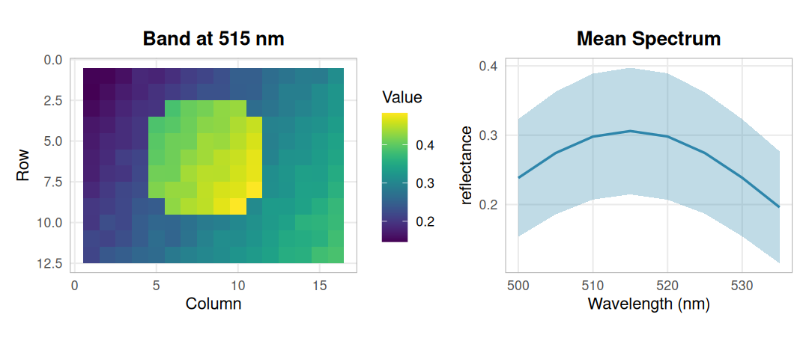
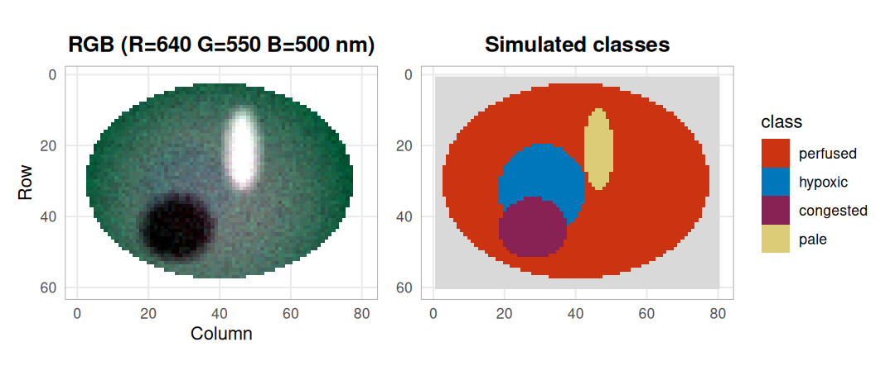
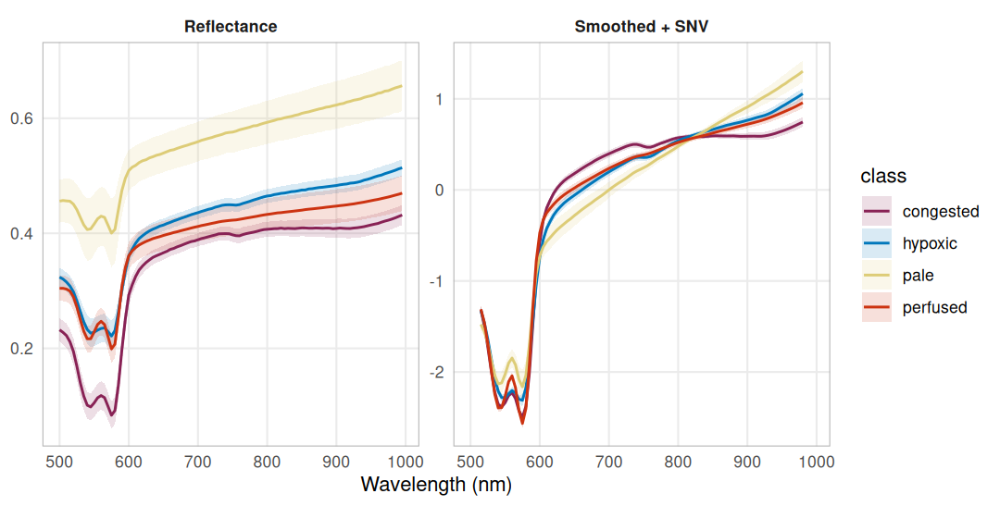
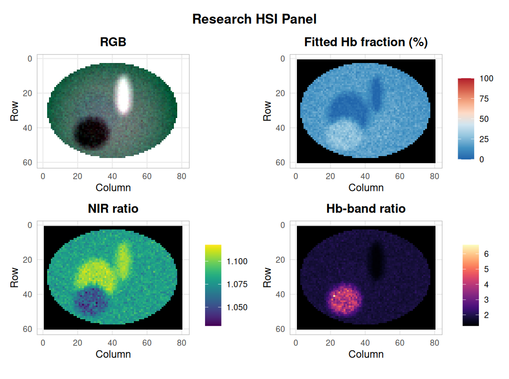
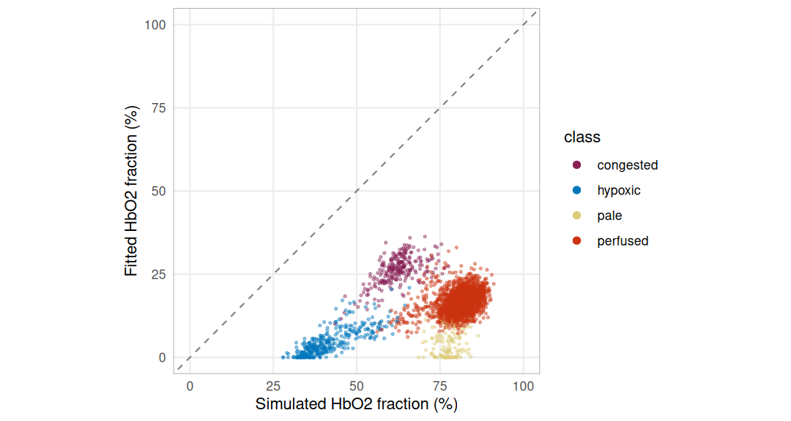
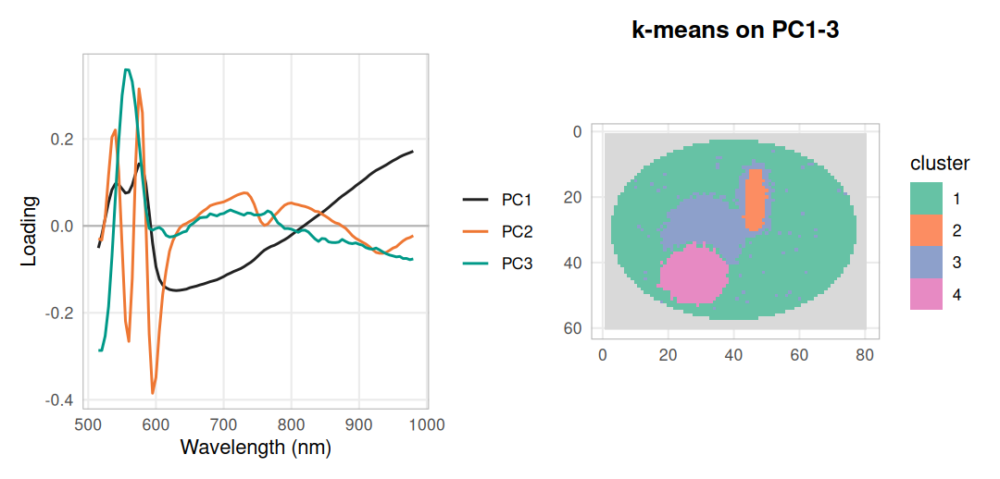
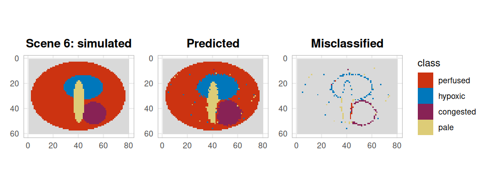
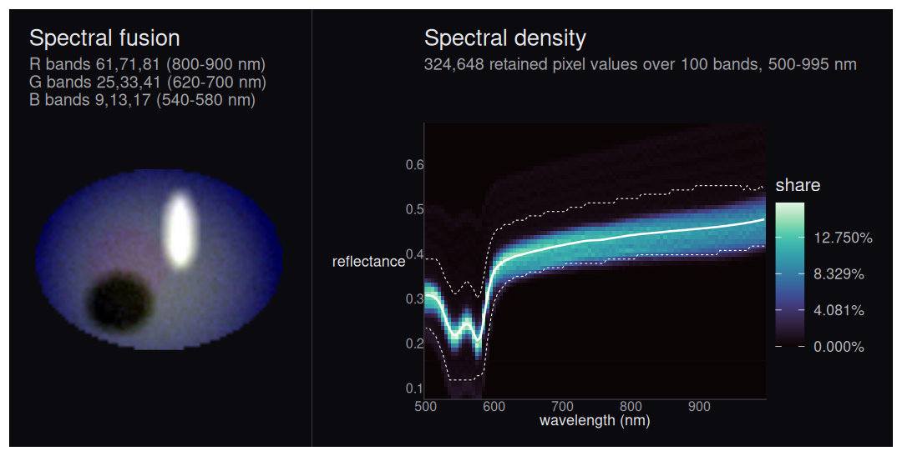

A hyperspectral camera records a reflectance spectrum at every pixel. This
walkthrough follows one path through the CTTIR hyperspectral suite: read a
recording, preprocess the cube, fit hemoglobin, reduce and classify the
spectra, and summarise them visually. The tissue scenes are simulated, so the
right answer is known in advance. That is deliberate: it lets us check what
each step recovers and where it goes wrong.

## Install the suite

`hyperloom` installs the four member packages and their dependencies. It has
no functions of its own and attaches nothing, so the members are loaded
directly.


``` r
# remotes::install_github("CTTIR/hyperloom")
trimws(strsplit(packageDescription("hyperloom")$Imports, ",")[[1]])
```

```
#> [1] "hyperspectR"     "hyperspectaculR" "cuvis.r"         "tivis.r"
```

``` r
library(tivis.r)
library(cuvis.r)
library(hyperspectR)
library(hyperspectaculR)
library(ggplot2)
library(patchwork)
```

## Read a TIVITA recording

The Diaspective TIVITA Suite stores each capture as a binary
`*_SpecCube.dat` file next to a `*_meta.log`. `tivis.r` reads both in pure R.
The header is read first, without touching the samples:


``` r
f <- tivis_example_file()
basename(f)
```

```
#> [1] "example_SpecCube.dat"
```

``` r
str(tivis_read_header(f))
```

```
#> List of 5
#>  $ width    : int 16
#>  $ height   : int 12
#>  $ bands    : int 8
#>  $ n_values : num 1536
#>  $ file_size: num 6156
```

``` r
meta <- tivis_get_metadata(sub("_SpecCube[.]dat$", "_meta.log", f))
meta$Aufnahme$Aufnahmemodus
```

```
#> [1] "Reflektanz"
```

`hs_read_tivita()` calls the same reader and returns an `hsi_cube`, the class
that the rest of the suite works on. It carries the wavelengths, a pixel mask
and the acquisition metadata.


``` r
rec <- hs_read_tivita(f, verbose = FALSE)
rec
```


``` r
hs_plot_image(rec, wavelength = 515) + hs_plot_spectra(rec)
```

<div class="figure" style="text-align: center">

<p class="caption">The bundled recording at 515 nm and its mean spectrum (± 1 SD): a smooth gradient with a bright disc, read through the real TIVITA parser.</p>
</div>

A full TIVITA cube has 100 bands and is roughly 123 MB. The bundled file is a
small fixture with only the first eight bands: enough to exercise the parser,
too narrow for tissue indices. The rest of the walkthrough therefore uses
simulated scenes on the full TIVITA wavelength grid.

## Check the Cubert SDK

Cubert snapshot cameras write `.cu3s` session files that only the vendor's
CUVIS SDK can decode. `cuvis.r` binds that SDK, and `hs_read_cubert()` uses it
to return the same `hsi_cube` class as the TIVITA reader. No session file ships
with the packages, so here we only confirm that the SDK is linked and list the
processing modes a recording can be reprocessed into.


``` r
cuvis_available()
```

```
#> [1] TRUE
```

``` r
if (cuvis_available()) cuvis_version()
```

```
#> [1] "CUBERT SDK v. 3.5.3 build: 0f416fb6327f26644290b554c9b16050a515b89d"
```

``` r
cuvis_processing_modes
```

```
#>              Raw     DarkSubtract      Reflectance SpectralRadiance 
#>                0                1                2                3 
#>          Preview 
#>                5
```

## Simulate tissue scenes

Each scene is an elliptical field of tissue on a dark drape. Four tissue
types differ only in three parameters: the oxygenated fraction of hemoglobin,
total hemoglobin and a scattering factor.


``` r
tissue <- data.frame(
  class   = c("perfused", "hypoxic", "congested", "pale"),
  sto2    = c(0.80, 0.35, 0.60, 0.75),   # HbO2 / (HbO2 + Hb)
  thb_uM  = c(60, 60, 160, 15),          # total hemoglobin, µmol/L
  scatter = c(1.00, 1.00, 0.90, 1.35)
)
tissue
```

```
#>       class sto2 thb_uM scatter
#> 1  perfused 0.80     60    1.00
#> 2   hypoxic 0.35     60    1.00
#> 3 congested 0.60    160    0.90
#> 4      pale 0.75     15    1.35
```

Reflectance follows a simple Beer–Lambert model on a sloping scattering
baseline, with an optical path that lengthens into the near infrared. The
extinction coefficients are the tabulated values from `hs_chromophore_data()`
and the wavelength grid comes from `tivis_get_wavelengths()`. Region borders
are blurred, every pixel gets its own jitter, and illumination falls off from a
random hot spot. Scenes differ in layout, illumination and a scene-wide shift
in oxygenation.


``` r
wl  <- tivis_get_wavelengths(100L)                      # 500-995 nm
ext <- hs_chromophore_data(c("HbO2", "Hb"), wavelength_range = c(500, 996))
eps_o <- approx(ext$wavelength, ext$HbO2, wl)$y         # cm^-1 / (mol/L)
eps_d <- approx(ext$wavelength, ext$Hb, wl)$y

blur <- function(m, k = 5) {
  sm <- function(v) { s <- stats::filter(v, rep(1 / k, k)); ifelse(is.na(s), v, s) }
  apply(t(apply(m, 1, sm)), 2, sm)
}

simulate_scene <- function(seed, rows = 60, cols = 80) {
  set.seed(seed)
  y <- row(matrix(0, rows, cols)); x <- col(matrix(0, rows, cols))
  blob <- function(cx, cy, rx, ry) ((x - cx) / rx)^2 + ((y - cy) / ry)^2 < 1
  field <- blob(cols / 2, rows / 2, 0.47 * cols, 0.46 * rows)
  truth <- matrix("perfused", rows, cols)
  truth[blob(runif(1, 20, 60), runif(1, 15, 45), runif(1, 10, 16), runif(1, 8, 13))] <- "hypoxic"
  truth[blob(runif(1, 20, 60), runif(1, 15, 45), runif(1, 6, 10), runif(1, 6, 10))] <- "congested"
  truth[blob(runif(1, 15, 65), runif(1, 15, 45), runif(1, 4, 7), runif(1, 10, 18))] <- "pale"
  truth[!field] <- NA

  p <- tissue[match(truth, tissue$class), ]
  sto2 <- blur(matrix(p$sto2, rows)) + rnorm(1, 0, 0.04) + rnorm(rows * cols, 0, 0.03)
  sto2 <- pmin(pmax(sto2, 0), 1)
  thb  <- blur(matrix(p$thb_uM, rows)) * exp(rnorm(rows * cols, 0, 0.10))
  sca  <- blur(matrix(p$scatter, rows))
  light <- 1 - 1.4 * ((x - runif(1, 25, 55))^2 + (y - runif(1, 20, 40))^2) / (rows^2 + cols^2)

  path_cm  <- 0.06 * (wl / 500)^3              # longer light paths in the NIR
  baseline <- 0.40 + 0.15 * (wl - 500) / 495   # scattering background
  data <- array(0.03, c(rows, cols, length(wl)))
  for (i in which(field)) {
    mua <- 1e-6 * thb[i] * (sto2[i] * eps_o + (1 - sto2[i]) * eps_d)
    data[row(field)[i], col(field)[i], ] <- light[i] * sca[i] * baseline * 10^(-mua * path_cm)
  }
  data <- data + rnorm(length(data), 0, 0.004)
  sto2[!field] <- NA
  list(cube  = hsi_cube(data, wl, mask = field,
                        metadata = list(processing_mode = "reflectance")),
       truth = truth, sto2 = sto2)
}

scenes <- lapply(1:6, simulate_scene)
scene  <- scenes[[1]]
scene$cube
table(scene$truth)
```

```
#> 
#> congested   hypoxic      pale  perfused 
#>       262       356       150      2485
```


``` r
class_colours <- c(perfused = "#CC3311", hypoxic = "#0077BB",
                   congested = "#882255", pale = "#DDCC77")
show_map <- function(m, title) {
  df <- data.frame(row = as.vector(row(m)), col = as.vector(col(m)),
                   class = factor(as.vector(m), levels = names(class_colours)))
  ggplot(df, aes(col, row, fill = class)) + geom_raster() +
    scale_fill_manual(values = class_colours, breaks = names(class_colours),
                      na.value = "grey85", drop = FALSE) +
    scale_y_reverse() + coord_equal() + labs(title = title, x = NULL, y = NULL) +
    theme_hsi()
}
hs_plot_rgb(scene$cube, r = 640, g = 550, b = 500) + show_map(scene$truth, "Simulated classes")
```

<div class="figure" style="text-align: center">

<p class="caption">Scene 1 as a pseudo-colour image (left) and the classes it was simulated from (right, grey = drape). The pale stripe is bright and the congested patch dark; the hypoxic region is hard to see by eye.</p>
</div>

## Smooth and normalise

Preprocessing is written as a recipe, so exactly the same steps can be
re-applied to held-out data later: a Savitzky–Golay filter (7 bands, quadratic)
followed by standard normal variate (SNV) scaling, which removes the brightness
differences caused by uneven illumination. The filter only returns bands with
a full window, so three bands are lost at each end.


``` r
recipe <- hs_recipe(list(
  list(method = "smooth", args = list(window = 7L, poly = 2L)),
  list(method = "snv")
))
snv <- hs_process(scene$cube, recipe)$cube
range(snv$wavelengths)
```

```
#> [1] 515 980
```

``` r
snv$metadata$processing_mode
```

```
#> [1] "snv"
```


``` r
class_spectra <- function(cube, truth, step) {
  do.call(rbind, lapply(tissue$class, function(k) {
    s <- hs_roi_stats(cube, !is.na(truth) & truth == k)
    data.frame(step = step, class = k, wavelength = s$wavelength, mean = s$mean, sd = s$sd)
  }))
}
spec <- rbind(class_spectra(scene$cube, scene$truth, "Reflectance"),
              class_spectra(snv, scene$truth, "Smoothed + SNV"))
ggplot(spec, aes(wavelength, mean, colour = class, fill = class)) +
  geom_ribbon(aes(ymin = mean - sd, ymax = mean + sd), alpha = 0.15, colour = NA) +
  geom_line(linewidth = 0.7) +
  facet_wrap(~step, scales = "free_y") +
  scale_colour_manual(values = class_colours, aesthetics = c("colour", "fill")) +
  labs(x = "Wavelength (nm)", y = NULL) + theme_hsi()
```

<div class="figure" style="text-align: center">

<p class="caption">Class mean spectra ± 1 SD before and after preprocessing. Raw reflectance mixes tissue type with illumination; after SNV the classes differ in shape, around the 540/575 nm hemoglobin bands, between 600 and 800 nm and in the slope into the near infrared.</p>
</div>

## Hemoglobin fit and band ratios

`hs_beer_lambert()` converts reflectance to absorbance and fits the HbO2 and
Hb extinction spectra between 500 and 600 nm by non-negative least squares;
`hs_sto2()` returns the fitted HbO2 fraction. `hs_npi()` and `hs_thi()` are
dimensionless band ratios. `hs_plot_clinical()` puts them next to an RGB view
and masks the drape by its low reflectance.


``` r
hs_plot_clinical(scene$cube, indices = c("sto2", "npi", "thi"), ncol = 2)
```

<div class="figure" style="text-align: center">

<p class="caption">Fitted HbO2 fraction and two band ratios for scene 1. The congested patch stands out in every panel; the hypoxic and pale regions both read as a low fitted fraction.</p>
</div>

Because the scene is simulated, the fitted fraction can be checked against the
value that generated each pixel:


``` r
fit <- hs_beer_lambert(scene$cube)
cmp <- data.frame(class     = as.vector(scene$truth),
                  simulated = 100 * as.vector(scene$sto2),
                  fitted    = as.vector(fit$sto2))
cmp <- cmp[!is.na(cmp$class), ]
aggregate(cbind(simulated, fitted) ~ class, data = cmp,
          FUN = function(v) round(median(v), 1))
```

```
#>       class simulated fitted
#> 1 congested      62.6   26.6
#> 2   hypoxic      40.0    3.8
#> 3      pale      77.8    4.8
#> 4  perfused      81.5   16.5
```


``` r
ggplot(cmp, aes(simulated, fitted, colour = class)) +
  geom_abline(linetype = 2, colour = "grey50") +
  geom_point(size = 0.6, alpha = 0.4) +
  scale_colour_manual(values = class_colours) +
  guides(colour = guide_legend(override.aes = list(size = 2, alpha = 1))) +
  coord_equal(xlim = c(0, 100), ylim = c(0, 100)) +
  labs(x = "Simulated HbO2 fraction (%)", y = "Fitted HbO2 fraction (%)") + theme_hsi()
```

<div class="figure" style="text-align: center">

<p class="caption">Fitted against simulated HbO2 fraction per pixel; the dashed line is perfect agreement. The fit sits far below it, and lowest where there is least hemoglobin.</p>
</div>

The fit has no term for the scattering background, so the flat part of the
absorbance is taken up by the hemoglobin spectra, mostly by deoxyhemoglobin.
The less hemoglobin a pixel holds, the larger that bias: the pale class,
simulated at 75 %, comes out near the hypoxic one. The package documentation
describes the output as a research model estimate for this reason. Read it as
a relative, model-bound number, not as tissue oxygen saturation.

## Embedding and classification

### Unsupervised: PCA and k-means

PCA on the preprocessed cube gives a low-dimensional embedding whose loadings
are spectra and can be read directly. Clustering the first three scores asks
whether the classes emerge without labels.


``` r
pca <- hs_pca(snv, n_components = 3)
round(100 * pca$variance_explained, 1)
```

```
#> [1] 74.6 10.9  1.6
```

``` r
scores <- matrix(pca$scores, ncol = 3, dimnames = list(NULL, paste0("PC", 1:3)))
ok <- complete.cases(scores)
aggregate(round(scores[ok, ], 2), by = list(class = scene$truth[ok]), FUN = median)
```

```
#>       class   PC1   PC2   PC3
#> 1 congested -1.20  0.49  0.15
#> 2   hypoxic  0.57  0.52 -0.13
#> 3      pale  2.07  0.05  0.18
#> 4  perfused -0.08 -0.13 -0.01
```

``` r
round(cor(scores[ok, ], scene$sto2[ok])[, 1], 2)   # with the simulated HbO2 fraction
```

```
#>   PC1   PC2   PC3 
#> -0.13 -0.92  0.28
```

PC1 orders the classes from pale to congested, so it mainly follows how much
hemoglobin absorbs; its loading sets the 540–575 nm bands and the near
infrared against the 600–800 nm range. PC2 correlates
strongly with the simulated oxygenation. Its loading has peaks at 540 and
575 nm, the two oxyhemoglobin bands, and a trough at 555–560 nm, where
deoxyhemoglobin has its single band. The embedding is readable because its
axes are spectra.


``` r
set.seed(1)
km <- kmeans(scores[ok, ], centers = 4, nstart = 20)
table(simulated = scene$truth[ok], cluster = km$cluster)
```

```
#>            cluster
#> simulated      1    2    3    4
#>   congested    4    0    0  258
#>   hypoxic     22    0  327    7
#>   pale         1  105   44    0
#>   perfused  2320    0  132   33
```


``` r
loadings <- data.frame(wavelength = rep(snv$wavelengths, 3),
                       loading = as.vector(pca$loadings),
                       component = rep(paste0("PC", 1:3), each = length(snv$wavelengths)))
cluster_map <- matrix(NA_integer_, nrow(scene$truth), ncol(scene$truth))
cluster_map[ok] <- km$cluster
p_load <- ggplot(loadings, aes(wavelength, loading, colour = component)) +
  geom_hline(yintercept = 0, colour = "grey70") + geom_line(linewidth = 0.7) +
  scale_colour_manual(values = c(PC1 = "#222222", PC2 = "#EE7733", PC3 = "#009988")) +
  labs(x = "Wavelength (nm)", y = "Loading", colour = NULL) + theme_hsi()
p_clus <- ggplot(data.frame(row = as.vector(row(cluster_map)), col = as.vector(col(cluster_map)),
                            cluster = factor(as.vector(cluster_map))),
                 aes(col, row, fill = cluster)) + geom_raster() +
  scale_fill_brewer(palette = "Set2", breaks = as.character(1:4), na.value = "grey85") +
  scale_y_reverse() + coord_equal() + labs(title = "k-means on PC1-3", x = NULL, y = NULL) +
  theme_hsi()
p_load + p_clus + plot_layout(widths = c(1.2, 1))
```

<div class="figure" style="text-align: center">

<p class="caption">PCA loadings (left) and four k-means clusters on the first three scores (right). The clusters follow the simulated regions, with mixed pixels along the blurred borders and part of the pale stripe joining the hypoxic cluster.</p>
</div>

### Supervised, with whole scenes held out

Pixels from one image are not independent, so a classifier must be tested on
scenes it has never seen. `hs_grouped_evaluate()` does this: it fits the recipe
and the classifier on five scenes and predicts the sixth, in turn for each
scene. Sixty pixels per class are sampled from every scene.


``` r
set.seed(3)
px <- lapply(seq_along(scenes), function(s) {
  lab <- as.vector(scenes[[s]]$truth)
  idx <- unlist(lapply(split(which(!is.na(lab)), lab[!is.na(lab)]),
                       function(v) v[sample.int(length(v), 60)]))
  list(x = matrix(scenes[[s]]$cube$data, ncol = length(wl))[idx, ],
       label = lab[idx], scene = rep(paste("scene", s), length(idx)))
})
spectra <- do.call(rbind, lapply(px, `[[`, "x"))
labels  <- unlist(lapply(px, `[[`, "label"))
groups  <- unlist(lapply(px, `[[`, "scene"))

ev <- hs_grouped_evaluate(spectra, wl, labels, groups, n_folds = 6,
                          method = "svm", recipe = recipe, bootstrap = 500)
round(c(accuracy = ev$accuracy, lower = ev$accuracy_interval[1],
        upper = ev$accuracy_interval[2], balanced = ev$balanced_accuracy), 3)
```

```
#> accuracy    lower    upper balanced 
#>    0.958    0.945    0.971    0.958
```

``` r
ev$confusion
```

```
#>            predicted
#> observed    congested hypoxic pale perfused
#>   congested       354       2    0        4
#>   hypoxic           5     349    2        4
#>   pale              2       5  336       17
#>   perfused          7       8    4      341
```

The interval resamples whole scenes, not pixels. With six scenes it is narrow
only because the simulated scenes are alike.

To see where the errors fall, the same recipe and an SVM are fitted on the
sampled pixels of scenes 1–5 and applied to every pixel of scene 6.
`hs_predict()` checks that the new cube went through the same preprocessing.


``` r
train <- groups != "scene 6"
train_cube <- hsi_cube(array(spectra[train, ], c(sum(train), 1, length(wl))), wl,
                       metadata = list(processing_mode = "reflectance"))
fitted <- hs_process(train_cube, recipe)
model  <- hs_classify_svm(fitted$cube, matrix(labels[train], ncol = 1))
test   <- hs_process(scenes[[6]]$cube, fitted$recipe, learn = FALSE)$cube
pred   <- hs_predict(model, test)
round(mean(pred == scenes[[6]]$truth, na.rm = TRUE), 3)
```

```
#> [1] 0.945
```


``` r
wrong <- pred
wrong[!is.na(pred) & pred == scenes[[6]]$truth] <- NA
show_map(scenes[[6]]$truth, "Scene 6: simulated") +
  show_map(pred, "Predicted") +
  show_map(wrong, "Misclassified") +
  plot_layout(guides = "collect")
```

<div class="figure" style="text-align: center">

<p class="caption">The held-out scene: simulated classes, SVM prediction, and the misclassified pixels coloured by their wrong prediction. Errors sit along region borders, where blurred parameters give spectra between two classes.</p>
</div>

## Spectral summaries

`hyperspectaculR` renders a cube as images that describe its values, and
records what it selected and how it stretched them. A three-channel fusion
maps near-infrared, red and green bands to R, G and B; the spectral density
shows how reflectance is distributed in every band across the tissue pixels.
Both plots carry a long caption with these details; it is dropped here for
space, and the full record stays available through `hsa_provenance()`. The
masked drape is left transparent.


``` r
fusion <- hsa_fusion(scene$cube, red = c(800, 850, 900), green = c(620, 660, 700),
                     blue = c(540, 560, 580), by = "wavelength")
density <- hsa_spectral_density(scene$cube, nbins = 64, normalise = "band",
                                value_label = "reflectance")
fusion + labs(caption = NULL) + density + labs(caption = NULL) +
  plot_layout(widths = c(1, 1.3))
```

<div class="figure" style="text-align: center">

<p class="caption">False-colour fusion of scene 1 (left) and the per-band distribution of tissue reflectance (right, white line = binned mean, dashed = 5-95 % envelope). The pale stripe and the congested patch form faint ridges above and below the main band.</p>
</div>

``` r
sapply(hsa_provenance(fusion)$selection[c("red", "green", "blue")], `[[`, "coordinates")
```

```
#>      red green blue
#> [1,] 800   620  540
#> [2,] 850   660  560
#> [3,] 900   700  580
```

## What this shows, and its limits

The suite carries one object, `hsi_cube`, from file readers through a
recorded preprocessing recipe to embeddings, classifiers and figures. On the
simulated scenes, four tissue types were separable from their spectra alone.
K-means on three principal components recovered the regions without labels.
An SVM on smoothed, SNV-scaled spectra reached
95.8 % accuracy with whole scenes held out, and
94.5 % on every
tissue pixel of scene 6; the errors sit on region borders. Two spectral
features carry the separation: overall hemoglobin absorption (PC1, pale
against congested) and the shape of the 540–575 nm hemoglobin bands (PC2,
oxygenation).

The limits are as important. The data are simulated from a simple forward
model, and the same extinction table drives simulation and fitting, so
these numbers say the pipeline works, not that tissue can be classified.
Real recordings add specular highlights, motion, camera noise and tissue
types that do not follow four parameter sets. The fitted HbO2 fraction is
strongly biased by scattering and should not be read as oxygen saturation.
Neither the TIVITA fixture nor the Cubert check involved a real capture. A
real study would label regions on recordings from independent patients and
pass the patient as the group to `hs_grouped_evaluate()`.

## Package versions


``` r
pkgs <- c("hyperloom", "tivis.r", "cuvis.r", "hyperspectR", "hyperspectaculR")
knitr::kable(data.frame(
  package = pkgs,
  version = vapply(pkgs, function(p) as.character(packageVersion(p)), ""),
  commit  = vapply(pkgs, function(p) packageDescription(p)$RemoteSha %||% NA_character_, "")
), row.names = FALSE)
```


|package         |version    |commit                                   |
|:---------------|:----------|:----------------------------------------|
|hyperloom       |0.1.1      |bfd38304aa1e89e783a904172070511d2485868f |
|tivis.r         |0.1.0      |1a28d08f8a24fbeaed0e353ba81aa20f5f36831a |
|cuvis.r         |0.1.0      |89bb9c2a0b7480414e375db4a89097143e32c846 |
|hyperspectR     |0.2.0.9000 |09170d23b7c4191e550e2f8eb78868e8d2c3a087 |
|hyperspectaculR |0.2.0      |eb3067ad4e2101db0b1f2d820cf4d9d1715d9f5f |
