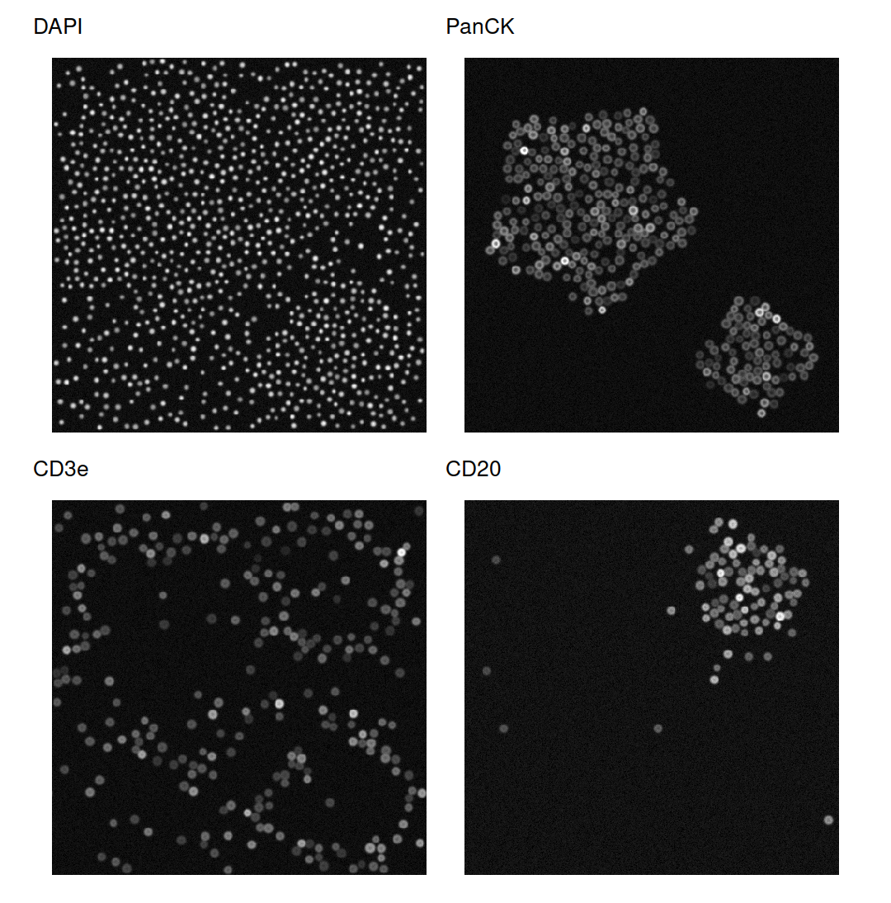
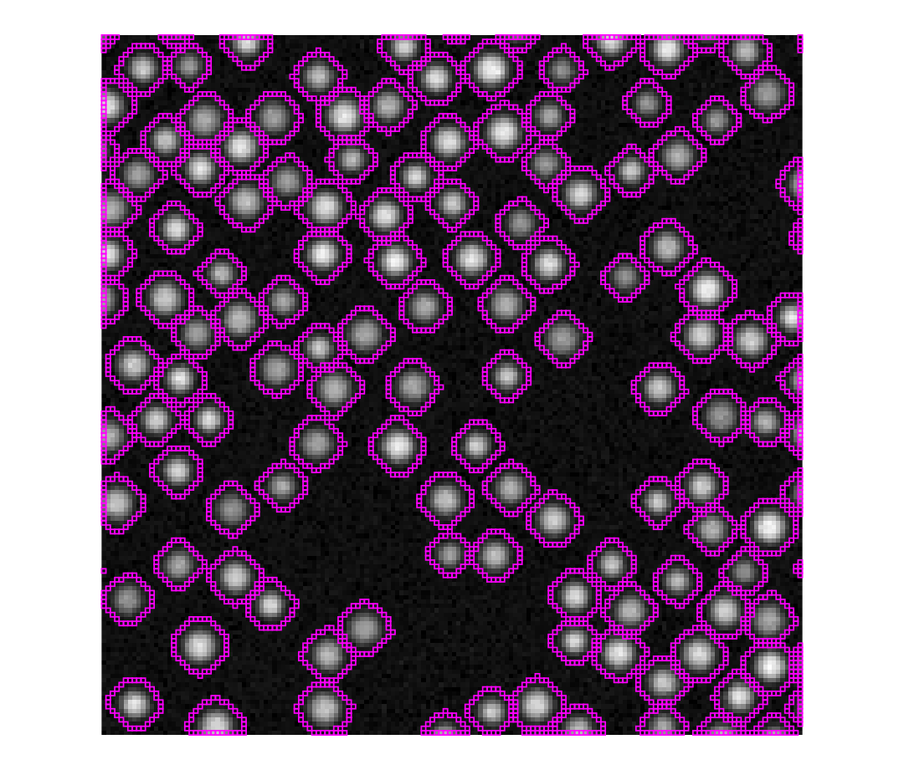
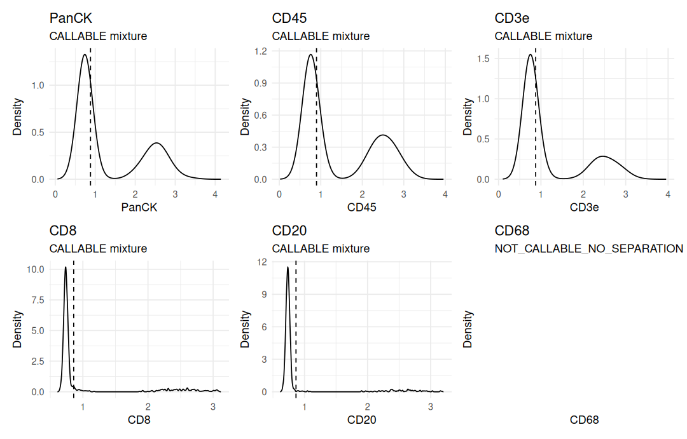
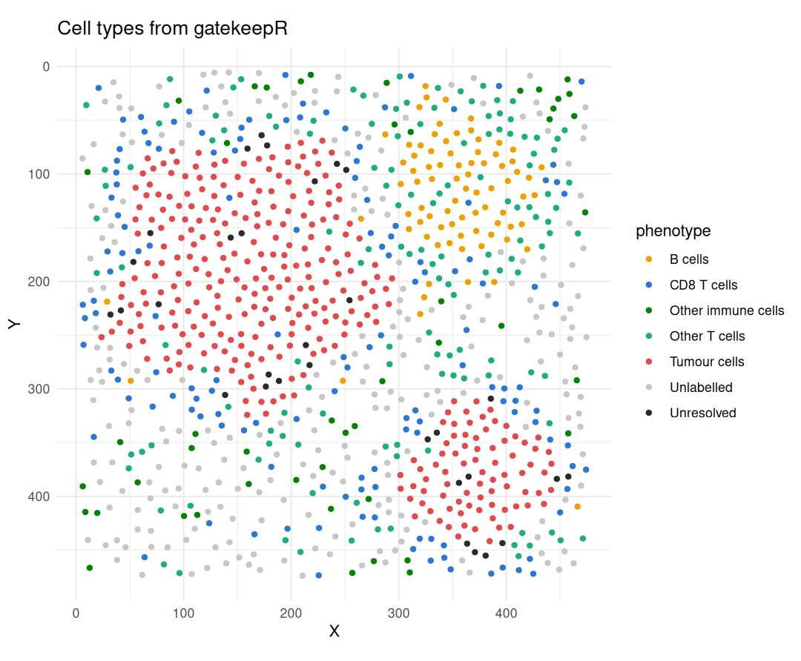
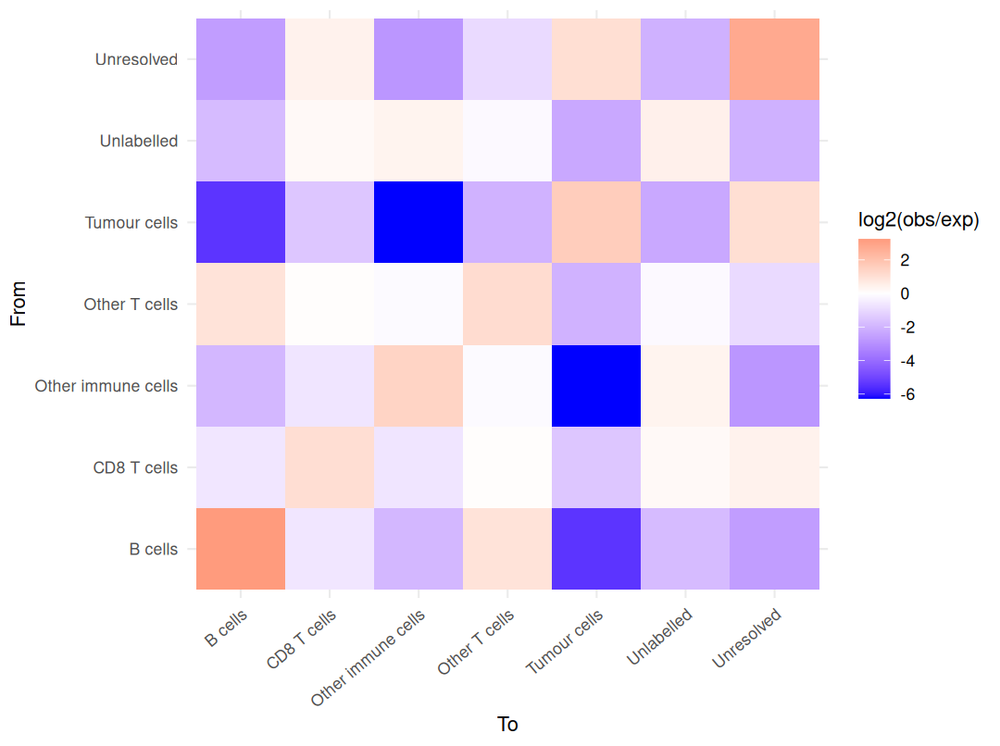
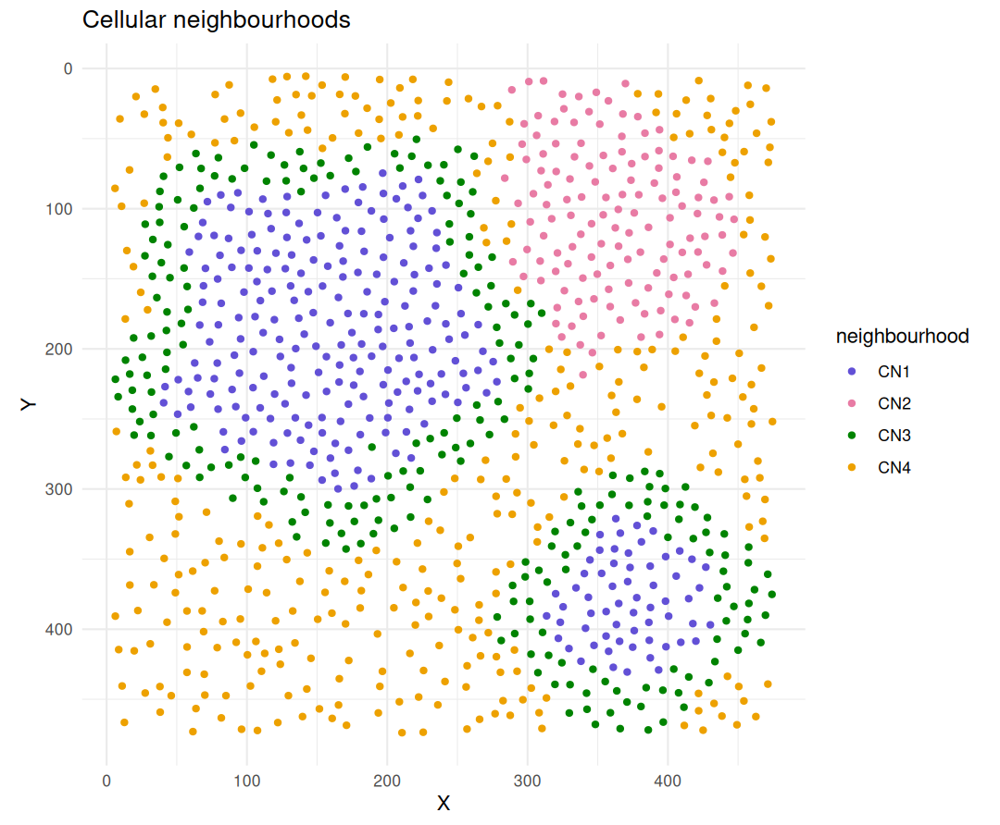

This walkthrough takes one multiplexed immunofluorescence image from pixels to
cell neighbourhoods with the packages of the phenoloom suite. segmantR finds
nuclei and cells, cellspecR turns the per-cell measurements into a validated
cell table, gatekeepR sets marker thresholds and assigns cell types, and
phenoscapR asks how those cell types are arranged. The image is synthetic, so
each step can be checked against the cells that were drawn.

## The suite

phenoloom exports no functions. Installing it installs its four member
packages, which are then loaded directly.


``` r
# install.packages("pak"); pak::pak("CTTIR/phenoloom")
suite <- trimws(strsplit(packageDescription("phenoloom")$Imports, ",")[[1]])
suite
```

```
#> [1] "segmantR"   "cellspecR"  "gatekeepR"  "phenoscapR"
```

``` r
for (p in suite) library(p, character.only = TRUE)
library(ggplot2)
```

## A synthetic section

The section is 480 × 480 µm. It holds a large and a small tumour nest of
PanCK-positive cells, a B-cell follicle (CD20) with a rim of T cells, and
sparse stroma. CD8 T cells gather at the tumour margin. Stromal cells carry
none of the markers, and myeloid cells carry only CD45: the CD68 channel was
acquired but holds no stain, as when an antibody fails. The code below draws
the cells, blurs the channels and adds background and noise. The matrix
`truth` keeps the drawn nuclei for later checks.

<details>
<summary>Code that draws the section</summary>


``` r
set.seed(2026)
side <- 480L                                         # pixels, 1 µm each
channels <- c("DAPI", "PanCK", "CD45", "CD3e", "CD8", "CD20", "CD68")

# Tissue compartment at pixel position (x to the right, y downwards)
compartment <- function(x, y) {
  outline <- function(cx, cy, r, wave, k, phase) {   # distance to a wavy edge
    sqrt((x - cx)^2 + (y - cy)^2) -
      r * (1 + wave * sin(k * atan2(y - cy, x - cx) + phase))
  }
  tumour <- pmin(outline(160, 190, 125, 0.12, 5, 0.7),
                 outline(375, 385, 70, 0.15, 4, 2))
  follicle <- sqrt((x - 365)^2 + (y - 110)^2) - 65
  out <- rep("stroma", length(x))
  out[follicle < 30] <- "T-cell zone"
  out[follicle < 0] <- "follicle"
  out[tumour >= 0 & tumour < 30] <- "margin"
  out[tumour < 0] <- "tumour"
  out
}
crowding <- c(tumour = 1, margin = 0.6, follicle = 1, "T-cell zone" = 0.6,
              stroma = 0.12)
mix <- list(
  tumour        = c(Tumour = .93, CD8T = .04, CD4T = .03),
  margin        = c(CD8T = .35, CD4T = .20, Stromal = .40, B = .05),
  follicle      = c(B = .82, CD4T = .14, CD8T = .04),
  "T-cell zone" = c(CD4T = .55, CD8T = .15, B = .15, Stromal = .15),
  stroma        = c(Stromal = .70, CD4T = .10, CD8T = .07, Myeloid = .13)
)
carries <- list(Tumour = "PanCK", CD8T = c("CD45", "CD3e", "CD8"),
                CD4T = c("CD45", "CD3e"), B = c("CD45", "CD20"),
                Myeloid = "CD45", Stromal = character())

# Cell centres: random candidates, thinned by compartment, >= 10 µm apart
cand <- matrix(runif(2 * 12000, 5, side - 5), ncol = 2)
cand <- cand[runif(nrow(cand)) < crowding[compartment(cand[, 1], cand[, 2])], ]
keep <- rep(FALSE, nrow(cand))
for (i in seq_len(nrow(cand))) {
  kept <- cand[keep, , drop = FALSE]
  keep[i] <- !any((kept[, 1] - cand[i, 1])^2 + (kept[, 2] - cand[i, 2])^2 < 100)
}
drawn <- data.frame(x = cand[keep, 1], y = cand[keep, 2])
drawn$compartment <- compartment(drawn$x, drawn$y)
drawn$type <- vapply(drawn$compartment,
                     function(r) sample(names(mix[[r]]), 1, prob = mix[[r]]), "")

# Paint nuclei (DAPI) and marker signal into a rows x columns x channels array
pixels <- array(0, c(side, side, length(channels)),
                dimnames = list(NULL, NULL, channels))
truth <- matrix(0L, side, side)                      # drawn nuclei by cell
for (k in seq_len(nrow(drawn))) {
  rn <- runif(1, 3, 4.2); rb <- rn + runif(1, 2, 3)  # nucleus, cell radius
  rows <- max(1, floor(drawn$y[k] - rb)):min(side, ceiling(drawn$y[k] + rb))
  cols <- max(1, floor(drawn$x[k] - rb)):min(side, ceiling(drawn$x[k] + rb))
  r <- sqrt(outer((rows - drawn$y[k])^2, (cols - drawn$x[k])^2, "+"))
  nucleus <- pmax(0, 1 - (r / rn)^4)
  body <- pmax(0, 1 - (r / rb)^6)
  pixels[rows, cols, "DAPI"] <- pmax(pixels[rows, cols, "DAPI"],
                                     runif(1, 0.55, 0.9) * nucleus)
  for (m in carries[[drawn$type[k]]]) {
    shape <- if (m == "PanCK") body * (1 - 0.6 * nucleus)  # cytoplasm
             else body * (0.5 + 0.5 * r / rb)                # membrane
    pixels[rows, cols, m] <- pmax(pixels[rows, cols, m],
                                  rlnorm(1, log(0.45), 0.35) * shape)
  }
  t_k <- truth[rows, cols]; t_k[r < rn & t_k == 0L] <- k; truth[rows, cols] <- t_k
}

# Blur (Gaussian, sigma 1 px), then add background and noise
smooth <- function(m) {
  w <- dnorm(-3:3); w <- w / sum(w)
  m <- apply(m, 2, stats::filter, filter = w, circular = TRUE)
  t(apply(m, 1, stats::filter, filter = w, circular = TRUE))
}
for (m in channels) {
  pixels[, , m] <- pmin(1, pmax(0, smooth(pixels[, , m]) + 0.04 +
                                   rnorm(side^2, 0, 0.02)))
}
```

</details>

The array becomes a segmantR image with its pixel size:


``` r
img <- new_sg_image(pixels, channels = channels,
                    resolution = list(x_um = 1, y_um = 1),
                    id = "synthetic-section", value_semantics = "intensity")
img
#> <sg_image>: 480 x 480 x 7 (7 channels: DAPI, PanCK, CD45, CD3e, CD8, CD20,
#> CD68)
#> ID: synthetic-section
#> Resolution: 1 x 1 um/px
#> Values: intensity
table(drawn$type)
#> 
#>       B    CD4T    CD8T Myeloid Stromal  Tumour 
#>      86     124     137      39     282     336
```


``` r
show_channel <- function(ch) {
  sg_plot_overlay(img, channel = match(ch, img$channels)) + labs(title = ch)
}
patchwork::wrap_plots(lapply(c("DAPI", "PanCK", "CD3e", "CD20"), show_channel))
```

<div class="figure" style="text-align: center">

<p class="caption">Four of the seven channels: nuclei (DAPI), the two tumour nests (PanCK), T cells at the tumour margin and around the follicle (CD3e), and the follicle at the top right (CD20).</p>
</div>

## Segmenting nuclei and cells

`sg_segment_watershed()` finds the DAPI foreground with Otsu's threshold,
takes as seeds the parts that lie deeper than 30% of the largest distance to
the background, and floods from these seeds.


``` r
nuclei <- sg_segment_watershed(img, channel = 1L, seed_method = "distance",
                               h = 0.3, expand_pixels = 0L)
```

```
#> ℹ Generated 1004 seeds via "distance".
#> ✔ Watershed segmented 1004 objects.
```

``` r
nuclei
```

```
#> <sg_mask>: 480 x 480, 1004 cells
#> Method: watershed
```

Because the nuclei were drawn, the result can be scored against them.
`sg_evaluate_segmentation()` compares every pair of objects, which takes long
on a whole section, so the check runs on a 160 × 160 µm window at the margin
of the large nest.


``` r
win <- 200:359                                      # rows and columns
scores <- sg_evaluate_segmentation(new_sg_mask(nuclei$labels[win, win]),
                                   new_sg_mask(truth[win, win]))
as.data.frame(scores)
```

```
#>             metric     value
#> 1             dice 0.8881220
#> 2          jaccard 0.7987585
#> 3              aji 0.7987585
#> 4 panoptic_quality 0.7734925
#> 5             ap50 0.9477612
#> 6             ap75 0.5535714
#> 7     f1_detection 0.9731801
```

Nearly every nucleus is found (detection F1 of
0.97 at an overlap of
0.5). Outlines agree less closely: at an overlap of 0.75 the average precision
drops to 0.55.

Cells are the nuclei grown outwards by up to three pixels. The pure R engine
is chosen explicitly: the EBImage engine ignores `expand_max` and would give
every background pixel to its nearest nucleus.


``` r
cells <- sg_segment_propagate(img, nuclei, expand_max = 3L,
                              engine = "voronoi_r")
```

```
#> ✔ Propagation assigned 1004 cells.
```

``` r
cells
```

```
#> <sg_mask>: 480 x 480, 1004 cells
#> Method: propagate:voronoi_r
```


``` r
window_img <- new_sg_image(img$pixels[win, win, ], channels = img$channels)
sg_plot_overlay(window_img, new_sg_mask(cells$labels[win, win]),
                channel = 1L, outline_width = 0.4)
```

<div class="figure" style="text-align: center">

<p class="caption">segmantR cell outlines (magenta) over DAPI in the 160 × 160 µm window used for scoring: one outline per nucleus.</p>
</div>

`sg_extract_features()` then measures every cell: intensity statistics per
channel, shape, and the centroid.


``` r
features <- sg_extract_features(
  img, cells, features = c("intensity", "morphology", "location"))
dim(features)
```

```
#> [1] 1004   57
```

``` r
features[1:3, c("cell_id", "area", "DAPI_mean", "PanCK_mean", "CD3e_mean",
                "centroid_row", "centroid_col")]
```

```
#> # A tibble: 3 × 7
#>   cell_id  area DAPI_mean PanCK_mean CD3e_mean centroid_row centroid_col
#>     <int> <int>     <dbl>      <dbl>     <dbl>        <dbl>        <dbl>
#> 1       1   118     0.277     0.0425    0.0415         5.99         142.
#> 2       2    96     0.214     0.0424    0.0406         6.26         129.
#> 3       3    82     0.195     0.0416    0.0380         6.56         171.
```

## A validated cell table

cellspecR reads the feature table through its segmantR adapter. The adapter
converts pixel centroids and areas to micrometres and names every
measurement by compartment, marker and statistic.


``` r
table_path <- file.path(tempdir(), "synthetic-section.tsv")
write.table(features, table_path, sep = "\t", quote = FALSE, row.names = FALSE)
cs_detect_format(table_path)[, c("format", "score")]
#>     format score
#> 1 segmantr  0.95
#> 2  mcquant  0.80
#> 3    table  0.50
section <- cs_read(table_path, format = "segmantr", pixel_size = 1,
                   sample_id = "synthetic-01")
section
#> <cellspec> 1.0.0: 1,004 cells, 1 image, 7 markers, 53 features
#> Markers: "DAPI", "PanCK", "CD45", "CD3e", "CD8", "CD20", and "CD68"
cs_validate(section)
#> <cellspec validation> 45 checks: 0 fail, 0 warn, 0 skip, 45 pass
#> pass 45 other checks
```

`cs_feature_support()` describes how much signal each marker carries. It
reports, but does not decide: the blank CD68 channel still varies through
noise and is listed as `ok`.


``` r
cs_feature_support(section)[, c("marker", "q01", "q50", "q99", "support")]
```

```
#>   marker        q01        q50        q99 support
#> 1   DAPI 0.18145001 0.22909513 0.28973010      ok
#> 2  PanCK 0.03563521 0.04175339 0.57167102      ok
#> 3   CD45 0.03645313 0.04414126 0.55325711      ok
#> 4   CD3e 0.03574278 0.04206239 0.53479178      ok
#> 5    CD8 0.03572565 0.04081717 0.50192246      ok
#> 6   CD20 0.03567037 0.04049882 0.45035523      ok
#> 7   CD68 0.03575033 0.04015570 0.04525087      ok
```

The table is written as a cellspec directory with a SHA-256 manifest, which
is what gatekeepR reads.


``` r
cellspec_dir <- file.path(tempdir(), "section-cellspec")
cs_write(section, cellspec_dir, overwrite = TRUE)
list.files(cellspec_dir)
```

```
#> [1] "cells.parquet"   "cellspec.json"   "DONE"            "MANIFEST.sha256"
```

## Gating cell populations

The gating configuration names the measurement behind each marker (mean cell
intensity), transforms it with asinh, and estimates one cut per marker with a
two-component mixture. The hierarchy is evaluated in order and the first rule
that matches wins. Cells positive for both PanCK and CD45 are flagged as
unresolved instead of being forced into a class.


``` r
markers <- c("PanCK", "CD45", "CD3e", "CD8", "CD20", "CD68")
config <- gk_config(
  signal_policy = gk_signal_policy(markers, compartment = "cell",
                                   statistic = "mean"),
  panel = gk_panel(markers, role = "identity", transform = "asinh",
                   cofactor = 0.05, threshold_method = "mixture"),
  hierarchy = gk_hierarchy(
    rules = list(
      gk_rule("R010", "Tumour cells", all_of = "PanCK", none_of = "CD45"),
      gk_rule("R020", "CD8 T cells", all_of = c("CD45", "CD3e", "CD8")),
      gk_rule("R030", "Other T cells", all_of = c("CD45", "CD3e")),
      gk_rule("R040", "B cells", all_of = c("CD45", "CD20"), none_of = "CD3e"),
      gk_rule("R050", "Macrophages", all_of = c("CD45", "CD68"),
              none_of = c("CD3e", "CD20")),
      gk_rule("R060", "Other immune cells", all_of = "CD45")
    ),
    flags = list(epithelial_immune = gk_flag(all_of = "PanCK", any_of = "CD45")),
    flag_policy = c(epithelial_immune = "unresolved"),
    undefined_label = "Unlabelled", version = "1.0"
  )
)
prepared <- gk_prepare(cellspec_dir, config, quiet = TRUE)
thresholds <- gk_thresholds(prepared, config)
as.data.frame(thresholds)[, c("marker", "method", "status", "estimate")]
```

```
#>   marker  method                     status  estimate
#> 1  PanCK mixture                   CALLABLE 0.8814616
#> 2   CD45 mixture                   CALLABLE 0.8975207
#> 3   CD3e mixture                   CALLABLE 0.8763340
#> 4    CD8 mixture                   CALLABLE 0.8588867
#> 5   CD20 mixture                   CALLABLE 0.8654181
#> 6   CD68 mixture NOT_CALLABLE_NO_SEPARATION        NA
```


``` r
image <- unique(prepared$cells$image_id)
density_plots <- lapply(markers, function(m) {
  gk_plot_density(thresholds, m, image) +
    labs(title = m, caption = NULL) +
    theme_minimal(base_size = 9)
})
patchwork::wrap_plots(density_plots, nrow = 2)
```

<div class="figure" style="text-align: center">

<p class="caption">gatekeepR's density plot for each marker, with its cut (dashed). Five markers split into negative and positive cells. CD68 has no positive group, so gatekeepR reports it as not callable, fits no density and sets no cut; its panel stays empty.</p>
</div>

gatekeepR then classifies every cell. The macrophage rule needs CD68, so it is
switched off and recorded rather than applied with a guessed cut.


``` r
classified <- gk_classify(prepared, thresholds, config)
```

```
#> Warning: 1 hierarchy rule disabled because required markers are not callable.
```

``` r
classified$disabled_rules
```

```
#>            image_id rule_id       label
#> 1 synthetic-section    R050 Macrophages
#>                                             reason markers
#> 1 A required marker is not callable on this image.    CD68
```

``` r
counts <- summary(classified)
counts$proportion <- round(counts$proportion, 3)
counts[, c("cell_type", "n", "proportion")]
```

```
#>            cell_type   n proportion
#> 1            B cells  80      0.080
#> 2        CD8 T cells 140      0.139
#> 3 Other immune cells  48      0.048
#> 4      Other T cells 137      0.136
#> 5       Tumour cells 322      0.321
#> 6         Unlabelled 246      0.245
#> 7         Unresolved  31      0.031
```

The drawn type of each segmented cell is that of the drawn nucleus under its
centroid, so the gating can be checked cell by cell.


``` r
centroid <- cbind(round(features$centroid_row), round(features$centroid_col))
drawn_id <- truth[centroid]
drawn_type <- c("none", drawn$type)[drawn_id + 1L]
calls <- classified$cells
gated <- calls$cell_type[match(as.character(features$cell_id), calls$cell_id)]
table(gated = gated, drawn = drawn_type)
```

```
#>                     drawn
#> gated                  B CD4T CD8T Myeloid Stromal Tumour
#>   B cells             77    0    0       1       2      0
#>   CD8 T cells          2    5  126       0       7      0
#>   Other immune cells   0    0    0      34      14      0
#>   Other T cells        7  116    0       4      10      0
#>   Tumour cells         0    0    0       0       3    319
#>   Unlabelled           0    0    0       0     246      0
#>   Unresolved           0    3   11       0       0     17
```

``` r
expected <- c(Tumour = "Tumour cells", CD8T = "CD8 T cells",
              CD4T = "Other T cells", B = "B cells",
              Myeloid = "Other immune cells", Stromal = "Unlabelled")
agreement <- mean(gated == expected[drawn_type])
round(agreement, 3)
```

```
#> [1] 0.914
```

Where do the remaining cells go wrong? Each disagreement is checked for a
drawn neighbour of another type within 12 µm:


``` r
wrong <- which(gated != expected[drawn_type])
touching <- vapply(wrong, function(i) {
  k <- drawn_id[i]
  d <- sqrt((drawn$x - drawn$x[k])^2 + (drawn$y - drawn$y[k])^2)
  any(d > 0 & d < 12 & drawn$type != drawn$type[k])
}, logical(1))
c(disagreements = length(wrong), next_to_other_type = sum(touching))
```

```
#>      disagreements next_to_other_type 
#>                 86                 86
```

Of the 86 disagreements, 86 lie next to a cell of
another type. A cell grown three pixels around its nucleus also takes up
signal from its neighbours, which lifts it into the shoulder just right of
the negative peak, where the mixture cuts lie. Tumour cells next to CD8 T
cells and CD8 T cells next to tumour cells thus end up "Unresolved", and some
stromal cells take on an immune neighbour's markers.

## Spatial neighbourhoods

phenoscapR imports the cellspec table without changing coordinates or
measurements. The gatekeepR labels are joined by cell identifier.


``` r
means <- cs_features(section, kind = "intensity", statistic = "mean")
tissue <- FromCellspec(section, features = means)
tissue@meta_data$phenotype <-
  calls$cell_type[match(tissue@meta_data$cell_id, calls$cell_id)]
tissue
```

```
#> A SpatialCellData object
#>   1004 cells across 1 sample
#>   Markers: cell:DAPI:mean, cell:PanCK:mean, cell:CD45:mean, cell:CD3e:mean, cell:CD8:mean, ... (7 total) 
#>   Normalised: FALSE 
#>   Phenotypes: 7 
#>   Project: SpatialProject
```


``` r
type_colours <- c("Tumour cells" = "#e34948", "CD8 T cells" = "#2a78d6",
                  "Other T cells" = "#1baf7a", "B cells" = "#eda100",
                  "Other immune cells" = "#008300", "Unlabelled" = "#c9c7c1",
                  "Unresolved" = "#2b2a28")
CellMap(tissue, colours = type_colours, pt_size = 1.3,
        title = "Cell types from gatekeepR") +
  scale_y_reverse()
```

<div class="figure" style="text-align: center">

<p class="caption">gatekeepR cell types in tissue coordinates, y pointing down as in the image: tumour nests, the B-cell follicle with its T-cell rim, and CD8 T cells along the tumour edge.</p>
</div>

`InteractionMatrix()` counts, for every pair of cell types, how often they lie
within 20 µm of each other, and compares this with 199 random relabellings of
the same cells.


``` r
pairs <- InteractionMatrix(tissue, radius = 20, method = "permutation",
                           n_perm = 199L, seed = 1L)
InteractionPlot(pairs) +
  theme(axis.text.x = element_text(angle = 40, hjust = 1))
```

<div class="figure" style="text-align: center">

<p class="caption">Neighbours within 20 µm, log2 of observed over expected counts: red pairs meet more often than by chance, blue pairs less often.</p>
</div>

Tumour cells sit with tumour cells, and B cells with B cells and other T cells.
Read along the tumour column:


``` r
pairs_df <- as.data.frame(pairs)
near_tumour <- pairs_df[pairs_df$to == "Tumour cells",
                        c("from", "observed", "expected", "interaction_score",
                          "z_score")]
near_tumour[, 3:5] <- round(near_tumour[, 3:5], 2)
print(near_tumour[order(-near_tumour$interaction_score), ], row.names = FALSE)
```

```
#>                from observed expected interaction_score z_score
#>        Tumour cells     1628   525.24              1.63   40.39
#>          Unresolved      104    49.70              1.07    8.52
#>         CD8 T cells       78   225.91             -1.53  -10.46
#>       Other T cells       53   220.72             -2.06  -13.73
#>          Unlabelled       78   395.99             -2.34  -18.59
#>             B cells        3   130.07             -5.44  -13.83
#>  Other immune cells        1    76.99             -6.27   -8.85
```

Every immune population lies next to tumour cells less often than by chance,
because the nests hold few immune cells, but CD8 T cells least so. The
distance from each cell to its nearest tumour cell, in micrometres, shows the
same margin from the other side:


``` r
to_tumour <- sapply(c("CD8 T cells", "Other T cells", "B cells"), function(type) {
  quantile(CrossNNDistance(tissue, from = type, to = "Tumour cells"),
           c(0.25, 0.5, 0.75))
})
round(to_tumour, 1)
```

```
#>     CD8 T cells Other T cells B cells
#> 25%        19.3          27.9    69.9
#> 50%        26.8          52.7    96.7
#> 75%        39.3         119.8   121.5
```

Finally, `CellularNeighbourhoods()` describes each cell by the cell types among
its 15 nearest neighbours and clusters these profiles into four neighbourhoods.


``` r
tissue <- CellularNeighbourhoods(tissue, n_neighbourhoods = 4L, k = 15L,
                                 seed = 1L)
round(tissue@spatial$neighbourhood_composition, 2)
```

```
#>     B cells CD8 T cells Other immune cells Other T cells Tumour cells
#> CN1    0.00        0.04               0.00          0.02         0.87
#> CN2    0.52        0.08               0.02          0.31         0.00
#> CN3    0.02        0.24               0.01          0.11         0.35
#> CN4    0.02        0.17               0.10          0.19         0.02
#>     Unlabelled Unresolved
#> CN1       0.02       0.06
#> CN2       0.07       0.00
#> CN3       0.20       0.07
#> CN4       0.49       0.01
```


``` r
cn_colours <- c(CN1 = "#6250d6", CN2 = "#e87ba4", CN3 = "#008300",
                CN4 = "#eda100")
CellMap(tissue, colour_by = "neighbourhood", colours = cn_colours,
        pt_size = 1.3, title = "Cellular neighbourhoods") +
  scale_y_reverse()
```

<div class="figure" style="text-align: center">

<p class="caption">Cellular neighbourhoods: tumour core (CN1), follicle with its T-cell rim (CN2), tumour margin (CN3) and stroma (CN4).</p>
</div>

The four neighbourhoods follow the drawn compartments without being told about
them. CN1 is mostly tumour cells, CN2 B cells and other T cells, CN3 a mix of
tumour cells, CD8 T cells and unlabelled cells along the nest edges, and CN4
about half unlabelled stromal cells with scattered immune cells.

## What this shows, and its limits

The four packages hand data to each other through documented objects: a
segmantR mask and feature table, a cellspec directory with checksums, a
gatekeepR classification, and a phenoscapR object. On this image the chain
recovers the drawn populations and their arrangement: the tumour nests, the
follicle, and CD8 T cells concentrated at the tumour margin. gatekeepR also
refused to call CD68, which carried no stain, and said so.

The image is deliberately easy. Nuclei are round, never overlap and sit at
least 10 µm apart, the signal has no autofluorescence or crosstalk beyond
blur, and there is a single section, so nothing here is a statistical result
about tissue. Even so, 9% of the cells get a
label that differs from the drawn type, because a cell's measurement picks up
its neighbours' signal and the automatic cuts sit close to the negative peak.
The cut-offs shown here are unreviewed. On real images, segmentation needs
review (segmantR's annotation and mask review tools), cut-offs need review and
locking in a snapshot (`gk_review()`, `gk_app()`, `gk_lock()`), and spatial
statistics need several sections and a study design before they mean
anything.

## Package versions


``` r
pkgs <- c("phenoloom", suite)
data.frame(package = pkgs,
           version = vapply(pkgs, function(p) format(packageVersion(p)), ""),
           commit = vapply(pkgs, function(p) packageDescription(p)$RemoteSha, ""),
           row.names = NULL)
```

```
#>      package version                                   commit
#> 1  phenoloom   0.1.1 16dae1ee98b1701bd15c10d3a09860fbc635a1f3
#> 2   segmantR   0.2.0 882c2fb7fe0546f71f6f11bbfd3de6103859b098
#> 3  cellspecR   1.1.0 bd940f1baf937cd6a78f8741193ac419d34c712b
#> 4  gatekeepR   1.0.0 64be151325ce36e6ff5fd1c576f341c96c69f1c2
#> 5 phenoscapR   0.2.0 d5959bd538374648ddb4207f8c54171ac48ebc32
```
